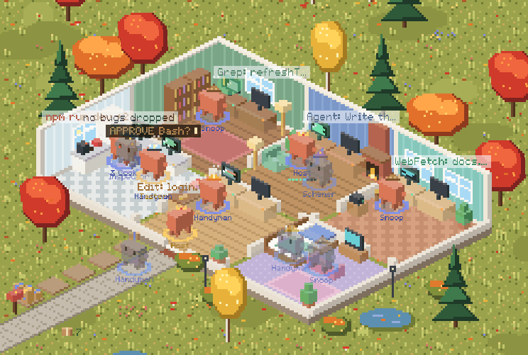
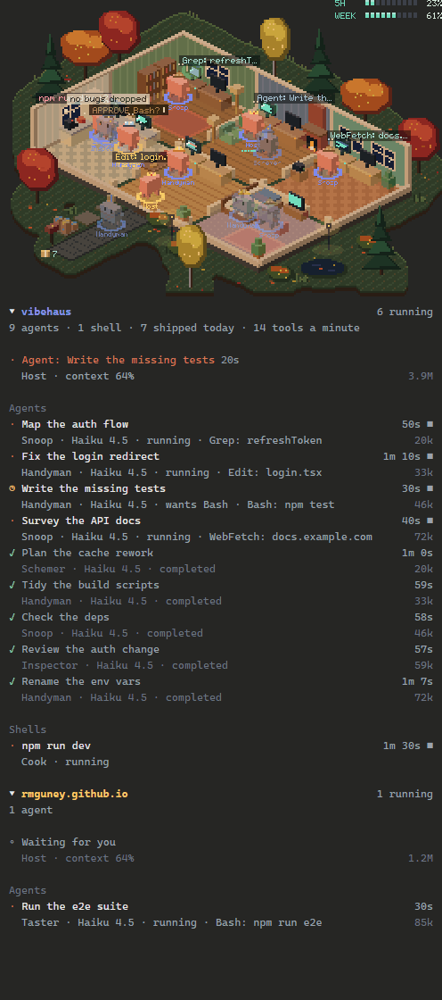
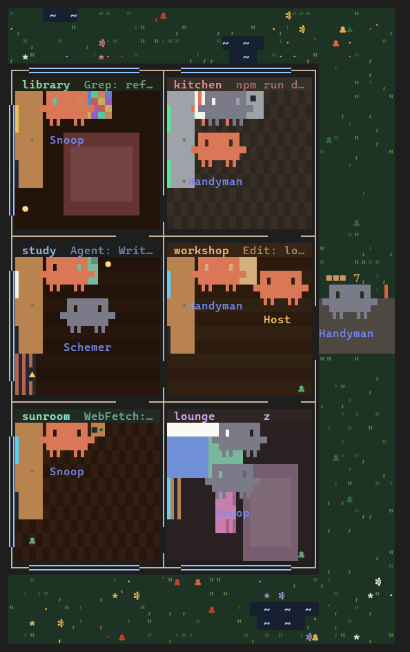

# Vibehaus

<picture>
  <source media="(prefers-color-scheme: dark)" srcset=".github/media/vibehaus-night.gif">
  
</picture>

A cozy pixel house for your Claude Code agents. Your lead agent, subagents and background tasks live in an isometric house in an autumn garden as Clawds: they work at desks in the room for each kind of job, carry a box out to the mailbox when they finish, and nap, read, watch TV or goof about when idle.

> Work in progress. Built on Claude Code's function hooks, which are early access and may change.

## What it shows



- **A room for each kind of work**: library (reading, search), study (the lead), sunroom (web and MCP tools), kitchen (shell), workshop (edits) and a bedroom lounge. Desk screens follow the tool in use; a permission prompt raises an amber tag.
- **Roles, with hats**: the lead is the Host in a crown, Explore agents are Snoops in deerstalkers, Plan agents the Schemer in a wizard's hat, general-purpose agents Handymen in hard hats; shells are Cooks in toques, monitors the Neighbor in a sun hat, workflows the Butler in a top hat. Other agent types take a role from their name, such as the Inspector, Taster or Scribbler.
- **Shipping**: each finished task walks out the front door with a box and stacks it on the pallets along the road, where the day's boxes from every session pile up by the mailbox.
- **Your other sessions** move in too: their agents walk in from the street and leave the same way. Each session has its own colour on rings at the feet, box tape and names.
- **Hover cards** for every agent in the house, on the desktop and in a terminal: who it is, its task, what it is doing, for how long, how many tokens (this session's own) and whose session it came from.
- **A garden all round**: the house stays centred in the pane, and a taller pane shows more of the autumn garden above and below it: copses and lone trees, ponds big and small, flower beds, stones and toadstools, with fireflies by night.
- **Vibe Fatigue**: a band right above the prompt with your five-hour and weekly usage and when each resets, beside the **◧ Vibehaus** button. Every session shows the newest reading any of them took. Claude Code reads these only on a Claude subscription; elsewhere the bars show `--`.
- On the desktop, light mode is a sunny day and dark mode a lamplit night.

Your background tasks themselves are listed in Claude Code's own background tasks view; in Vibehaus they live in the house as Clawds.

<br clear="right">

## In a terminal



A terminal can't show the picture, so there the house is drawn as a floor plan from above, in the terminal's own character cells, and stays crisp at any size.

- **Turned to fit a docked pane**: the plan is rotated a quarter turn, so the rooms run down the pane in two columns, with the yard and front door at the side.
- **The same rooms and furniture**: each room is a box with its name over it, holding what the picture has: desks and their screens, bookshelves, the fireplace, the fridge and stove, the workbench, beds, the TV and the couch. Desk screens change colour with the tool in use.
- **Every agent is a Clawd**, drawn the way Claude Code draws its own, with its role written under it. They walk from room to room as they do on the desktop, while fires, screens and lights flicker. Hover a Clawd for its card.
- **The yard** holds the day's boxes by the mailbox.
- **As tall as the pane**: the plan grows with the pane, up to rooms about as tall as they are wide, and stays in its middle; the garden fills the rows above and below it, with copses of autumn trees and pines, flowers, fallen leaves and ponds.
- **Vibe Fatigue** and the **◧ Vibehaus** button sit in the band above the prompt, as on the desktop.

<br clear="right">

## Install

```
/plugin install vibehaus --marketplace rmguney/vibehaus
```

Needs Claude Code 2.1.295 or later, in the terminal or the desktop Code tab. Tested on 2.1.299 and 2.1.301.

Where an organization manages Claude Code, its classic hooks run only for plugins the organization allows. Without them there is no amber tag, no sync with the background tasks list and no session titles.

## Use

- It opens when a session starts (in a terminal 144 columns wide or more, 110 once you have opened it, until you close it by hand); `/haus` opens it anywhere.
- `/haus demo` moves a made-up household in for five minutes; run it again to send them home.
- `/haus snapshot` saves the house as `vibehaus-snapshot.svg`, an animated SVG, in the folder Claude Code runs in.
- **◧ Vibehaus** in the band above the prompt opens or closes it; the band also shows your vibe fatigue. It gives way while Claude Code shows a survey there.

## Privacy and permissions

- **What it sends**: nothing. It contacts no host and never uses your sign-in: the vibe fatigue bars show Claude Code's own readings of your five-hour and weekly windows, off its responses.
- **What it writes**: `vibehaus-snapshot.svg` in the folder Claude Code runs in, over the last one, only when you run `/haus snapshot`. It edits no build, start-up, settings or instructions file. It shows what this session's agents are doing as the house does, commands included, so look it over before you share it. Besides that only Claude Code's local plugin store, which every session on this machine reads, whatever its project. It holds the Host's token counts, the newest five-hour and weekly reading, when each box shipped, and each session's household: the session's title (its folder's name until it has one), and for each member its id, agent type, role, task name, room and status, when it started, last worked and finished and the times of its last few tool calls, whether its last call failed, the tool in use (with the file's name for file tools), and the Host's context use. Never a command, pattern, address or query.
- **What it runs**: nothing. It calls no tools, runs no commands or processes and starts no agents. It adds the `/haus` command and answers only that one.
- **What its hooks do**: they watch, and pass everything on unchanged. None blocks, rewrites or answers an event, other than its own `/haus` command, pane and band.
  - `session.start` adds `/haus` and clears stale entries from the store; `session.end` takes the session's household out of the store.
  - `command.run` answers `/haus` alone. Every other command, and any made by other code, goes by untouched.
  - `session.measure` reads the five-hour and weekly windows from Claude Code's measurements.
  - `tool.call` puts each agent in the room for its tool and picks up the background tasks it starts. The call and its result go on as they were.
  - `agent.spawn`, `turn.start`, `turn.complete` and `turn.step` move agents in and out and count each one's tokens. The agent, turn and request go on as they were.
  - `session.append` reads background tasks' end notices from the session's rows, and keeps every row as it is.
  - The classic events change nothing either: settings, instructions, other hooks' output and tool descriptions pass through them untouched.
    - `Stop` and `SubagentStop` sync the house with Claude Code's own list of background work.
    - `SessionStart` and `UserPromptSubmit` give the session's title; after a `/clear` or a resume, `SessionStart` sets the house up again.
    - `Notification` of a permission prompt raises the amber tag over the agent that asks. The plugin hooks no permission check: the prompt and your decision are untouched.
  - `ui.render` draws its own pane, and the band above the prompt, which it leaves to Claude Code's surveys whenever one is showing.
- It reads no credentials, environment variables or files, and depends on no other plugin. Like every mod it is not sandboxed; the source is plain TypeScript in `vibehaus/hooks/`.

## Develop

```
claude --plugin-dir vibehaus
node tests/run.mjs
claude plugin validate --strict .
claude plugin validate --strict vibehaus
npx -p typescript tsc -p vibehaus
npx -p typescript tsc -p tests
```

The tests sit in `tests/`, outside the plugin, so they are not installed with it; `tests/run.mjs` runs them in a copy of the plugin. The type checks use the types Claude Code writes into `vibehaus/.claude-plugin/types/` when it loads the plugin, so run `claude --plugin-dir vibehaus` once first.

## License

MIT, see [LICENSE](LICENSE). Clawd, the Claude Code mascot, and the Claude and Claude Code names are Anthropic's and not covered by the license. Vibehaus is an unofficial fan project, not affiliated with or endorsed by Anthropic.
